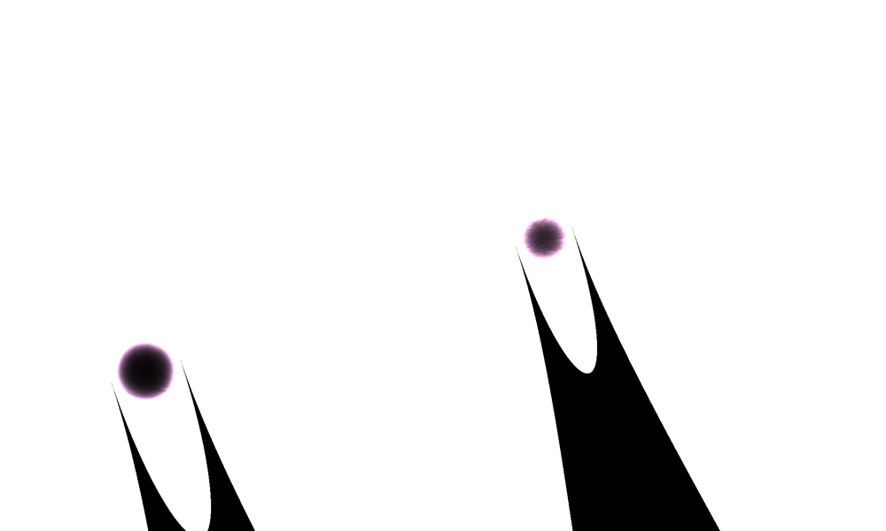
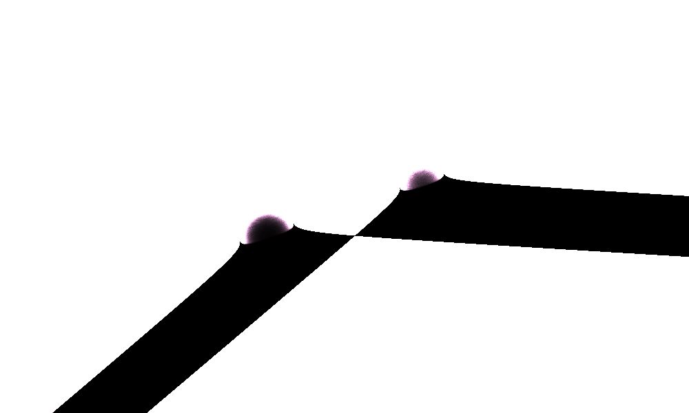

# 픽셀 수식 예시 — 전사 교정 기록 (2026-10-16)

번들 예시 수식(`PixelFormulaSamples.sample`, PRD FR-10)은 사용자가 수식 사진(IMG_4607, 1179×454px)을 LLM으로 전사해 붙여넣은 LaTeX 원문이다. 원작 그림(IMG_4609: 두 개의 블랙홀, 위로 뻗는 제트, 보라빛 소용돌이 배경)을 확보한 뒤 렌더 결과와 대조해 **전사 오류 2건을 확인·교정**했고, **아직 설명되지 않는 차이 1건**을 미해결로 남긴다.

## 교정 전 / 후

| 항목 | 교정 전 (전사 원문) | 교정 후 (사진 확대로 확인) | 근거 |
|---|---|---|---|
| H_v 첫 마스크의 원 중심 | `\left(x+\frac{y}{3}+\frac{3}{2}\right)^2` (지수 안·제곱근 안 모두) | `\left(x+\frac{y}{3}+\frac{1}{2}\right)^2` | 사진 확대 `Media/PixelFormula/formula-photo-mask1-zoom.png`에 1/2로 보임. 원작 그림에서 두 구멍은 회전 좌표 x′ = x + y/3 기준 약 −0.58, +0.51에 있어 ±1/2가 맞고, P·Q·A_s 정의도 모두 ±1/2를 쓴다. |
| 두 마스크의 제곱근 계수 | `+5\sqrt{\left\|\cdots\right\|}` (2곳) | `+\frac{2}{5}\sqrt{\left\|\cdots\right\|}` (2곳) | `formula-photo-mask1-zoom.png`, `formula-photo-mask2-zoom.png`에 세로 분수 2/5가 보임. |

변경 파일: `MathSketch/MathEngine/PixelFormula/PixelFormulaSamples.swift` (H_v 정의 4줄). 파서·렌더러 코드는 변경 없음.

## 렌더 비교

| 교정 전 | 교정 후 |
|---|---|
|  |  |
| 흰 바탕, 보라빛 원 2개, 아래로 뻗은 좁은 검은 원뿔. 왼쪽 원이 x′ = −1.5에 있어 원작보다 왼쪽·아래로 치우침. | 두 구멍이 원작과 같은 위치(x′ ≈ ±0.5, 왼쪽이 아래·오른쪽이 위). 제곱근 계수가 2/5로 작아지면서 마스크 항의 음수 영역이 넓은 쐐기로 커짐. 배경은 여전히 흰색. |

둘 다 CPU 평가기와 GPU 셰이더 결과가 일치하므로, 차이는 구현이 아니라 수식 원문에서 온다.

## 원작과 일치하는 것으로 확인된 구조

- **블랙홀 위치**: 원작의 두 구멍 좌표를 (m, n) → (x, y) → (x′, y′)로 환산하면 (−0.58, 0.05), (0.51, 0.03). 수식의 ±1/2, y′ ≈ −0.03과 일치.
- **제트**: B 항은 `e^{1000(|x′| − 7/10)}`로 |x′| < 0.7 띠에, `e^{-e^{-50(y′ − 7/50)}}`로 y′ > 0.14(구멍 위쪽)에 제한되고, `sin^6(T_s) ≈ 1`은 x′ = ±1/2 선 위에서 성립한다. 즉 두 구멍 바로 위로 올라가는 두 광선이며, x + y/3 = const 선의 기울기(위로 갈수록 왼쪽) 역시 원작의 제트 방향과 같다.
- **색 비율**: v별 가중치 (3/2 + ½(v−1)² + (4−4v)/10·cos s²)는 K₁/K₀ ≈ 0.74를 주고, 원작 배경 보라색의 G/R 비율도 약 0.73이다.

## 미해결: K_v 항의 크기

배경(구멍에서 0.3 이상 떨어진 임의의 40지점)에서 `20K_v/37`을 CPU 평가기로 재면 다음과 같다.

| 읽기 가정 | 평균 | 표준편차 | 최소~최대 |
|---|---|---|---|
| 전사 원문 그대로 | 12.59 | 1.20 | 9.5 ~ 14.7 |
| K_v 지수 끝 부호를 `+3/2 + A_s`로 가정 | 2.74 | 0.68 | 1.6 ~ 4.2 |
| K_v 지수 앞 계수를 `+3/2(`로 가정 | 12.82 | 1.12 | 10.2 ~ 14.7 |

원작처럼 배경이 보라빛 중간 톤이 되려면 이 값이 0.4~0.7이어야 한다(F(x)는 x ≥ 1에서 255로 포화). 부호·계수 하나를 바꾸는 가정으로는 1 아래로 내려오지 않으므로, K_v 줄(`formula-photo-kv-zoom.png`)에 **1179px 사진으로는 판독할 수 없는 기호 차이가 더 있다**고 결론지었다. 또한 마스크 항 `e^{-200(y′ + (2/5)√|…|)}`는 y′가 조금만 음수여도 폭발적으로 커져 구멍 아래 전체를 검게 만드는데, 원작에는 그런 영역이 없다 — 이 항도 제곱(`(\cdots)^2`, 얇은 곡선) 등 다른 형태일 가능성이 있으나 사진으로 확인되지 않는다.

**필요한 것**: K_v 줄과 H_v 마스크 항을 크게 찍은 고해상도 수식 이미지 또는 원문 출처. 확보되면 같은 절차(확대 판독 → 예시 수정 → CPU/GPU 렌더 → 원작 대조)로 마무리한다.

## 교훈

- 작품 스크린샷은 "그림 → 수식" 변환에는 쓸 수 없지만, 전사된 수식의 **검증**에는 결정적이다. 구멍 좌표 환산 하나로 1/2 vs 3/2가 바로 갈렸다.
- LLM/OCR 전사는 중첩 지수·세로 분수(2/5 vs 5)·아래첨자에서 틀리기 쉽다. 전사 결과는 반드시 렌더해서 원작과 대조할 것.
