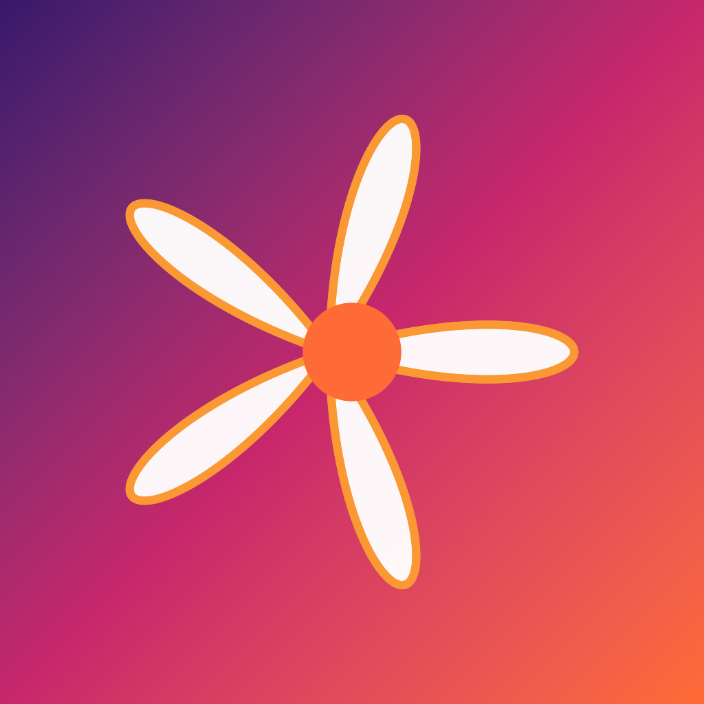
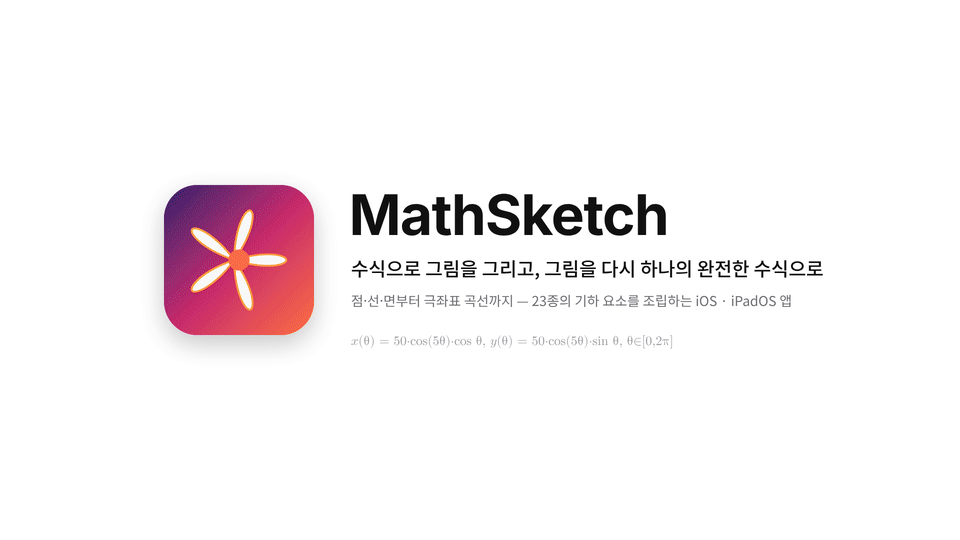
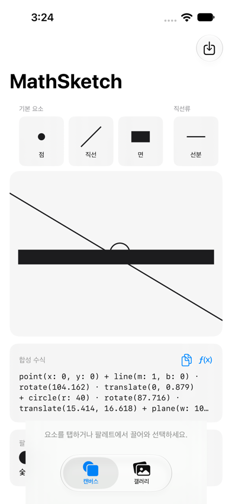
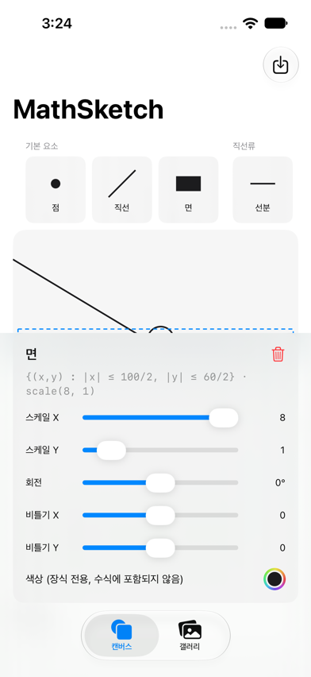
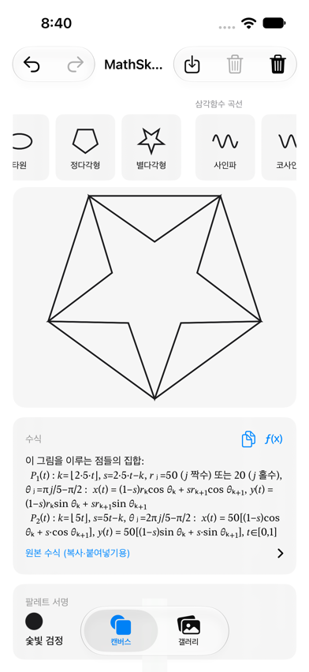
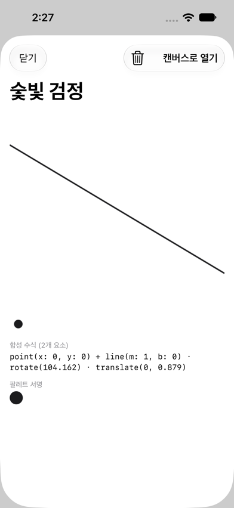
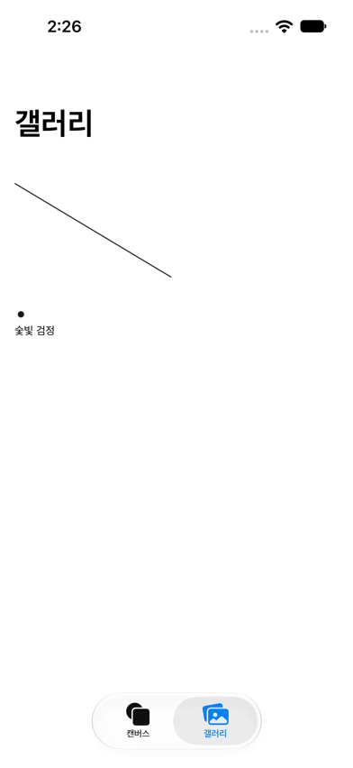
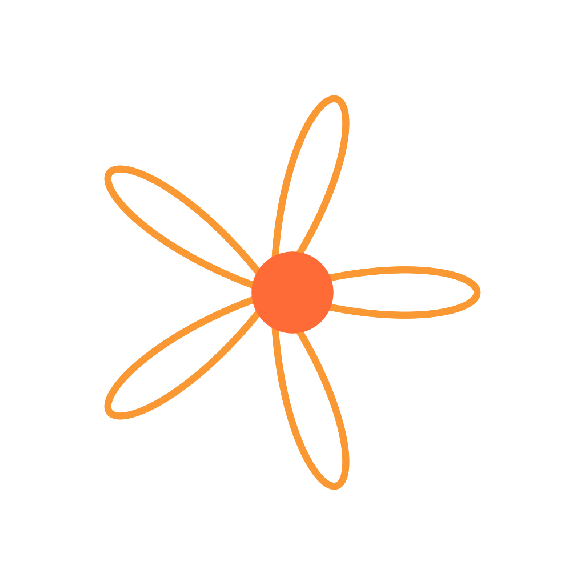

<div align="center">



# MathSketch

**수식으로 그림을 그리고, 그림을 다시 하나의 완전한 수식으로 — 점·선·면부터 극좌표 곡선까지, 23종의 기하 요소를 조립하는 iOS/iPadOS 앱**


<br/>



<sub>▶︎ 41초 소개 영상 (자동 재생) — 23종 수식 도형 → 드래그·핀치·회전·비틀기로 조립 → 그림 전체를 하나의 수식으로, 수식에서 다시 그리기 → 팔레트 서명 · 갤러리. <a href="Media/Video/intro.mp4">고화질 MP4로 보기</a></sub>

<br/><br/>

   

</div>

## 목차

- [소개](#소개)
- [핵심 기능](#핵심-기능)
- [스크린샷](#스크린샷)
- [앱 아이콘](#앱-아이콘)
- [아키텍처](#아키텍처)
- [요구 사항 및 실행](#요구-사항-및-실행)
- [테스트](#테스트)
- [알려진 제한사항](#알려진-제한사항)
- [참고 프로젝트](#참고-프로젝트)
- [라이선스](#라이선스)

## 소개

[`Formula Simplification`(Mathigram)](https://github.com) 프로젝트가 "그림 → Fourier 급수 수식"을 다뤘다면, **MathSketch**는 반대 방향이다: 점·선·면 같은 기본 기하 요소부터 원, 별, 사인파, 장미 곡선 같은 복잡한 매개변수 곡선까지 **23종의 "수식을 가진 도형"**을 팔레트에서 캔버스로 끌어와 조립하고, 이동·비균일 스케일·회전·비틀기(전단) 변형과 색을 입혀 하나의 그림을 완성한다.

캔버스에 놓인 모든 요소의 **도형 + 변형**은 실시간으로 하나의 순수 기하 수식(`SketchFormula` DSL) 문자열로 합쳐지고, 이 문자열을 복사해 다시 입력하면 동일한 그림이 즉시 재구성된다. 수식 패널에는 이 전체 수식이 **생략 없이, 각 요소마다 완전한 닫힌형 매개변수 방정식**으로 풀어서 보인다 — 정다각형·별다각형 같은 조각별 도형조차 바닥함수(⌊⌋)를 쓴 정식 방정식으로, "대충 요약된 설명"이 아니라 그림을 실제로 그려내는 수식 그 자체를 보여주는 것이 목표다. 색상은 의도적으로 이 수식에서 분리된 **장식 전용** 속성이며, 대신 캔버스에 쓰인 색들은 "팔레트 서명"이라는 감성적인 한글 이름 + 스와치로 따로 표현된다.

## 핵심 기능

- **23종 도형 팔레트** — 기본 요소(점·선·면), 직선류(선분/반직선/꺾은선/원호/베지어), 기본 폐도형(원/타원/정다각형/별), 삼각함수 곡선(사인/코사인/리사주), 극좌표·기하 곡선(나선/장미/카디오이드/아스트로이드/사이클로이드). 모든 도형은 기본 배치 시 비슷한 시각적 크기(지름 약 90~110)를 갖도록 매개변수가 맞춰져 있어, 섞어 놓아도 크기가 들쭉날쭉하지 않다.
- **실시간 제스처 변형** — 드래그로 이동, 두 손가락 핀치/회전으로 균일 스케일·회전, 인스펙터 슬라이더로 비균일 스케일·비틀기(전단)·색상까지 — 변형 중 수식 라벨이 매 프레임 수치로 갱신된다. 겹치거나 인접한 요소를 탭하면 패딩된 바운딩박스가 아니라 **실제 경로까지의 최단 거리**로 가장 가까운 도형을 정확히 집어낸다.
- **생략 없는 완전한 수식 표기** — 합성 수식 패널은 "이 그림을 이루는 점들의 집합:" 머리말 아래 각 요소를 𝑃₁(𝑡), 𝑃₂(𝑡)… 로 번호 매긴 이탤릭 수학 기호(𝑥, 𝑦, 𝑡) 표기로 보여주며, 아무리 길어져도 "..."로 잘리지 않는다. 그 아래 접이식 "원본 수식" 섹션에는 파싱·복사·붙여넣기용 `SketchFormula` DSL 원문이 그대로 남아 있다.
- **실행 취소 / 다시 실행 / 전체 지우기** — 제스처 단위(탭 1회가 아니라 드래그·핀치·회전·슬라이더 조작 1회)로 스냅샷을 쌓는 실행 취소 스택. 선택 요소 하나만 지우거나, 확인 알림을 거쳐 캔버스를 통째로 비울 수도 있다 — 모두 실행 취소로 되돌릴 수 있다.
- **팔레트 서명** — 색상은 수식에 포함되지 않는 장식 전용 속성. 대신 사용된 색을 모아 Lab 색공간 최근접 매칭으로 "노을빛 주황" 같은 한글 감성 이름을 붙이고, 갤러리 저장 시 제목으로 제안한다.
- **이중 영속성** — 작업 중 캔버스는 Core Data(고빈도 자동저장, Combine 디바운스)로 색까지 포함해 항상 복원되고, 완성작은 SwiftData 갤러리에 명시적으로 저장해 썸네일·수식·팔레트 서명과 함께 다시 열 수 있다.

## 스크린샷

<div align="center">


</div>
<p align="center"><sub>캔버스 탭 — 팔레트(기본 요소 점·선·면 포함) · 캔버스 · 합성 수식 패널 / 요소 선택 시 인스펙터(스케일·회전·비틀기 슬라이더 + 색상, 수식 라벨 실시간 갱신)</sub></p>

<div align="center">

</div>
<p align="center"><sub>실행취소·다시실행·선택삭제·전체삭제 툴바 + 정다각형·별다각형을 조합했을 때 생략 없이 끝까지 풀어쓴 합성 수식(바닥함수 포함 닫힌형 방정식)</sub></p>

<div align="center">


</div>
<p align="center"><sub>갤러리 그리드(팔레트 서명 기반 자동 제목 "숯빛 검정") / 상세 화면 — 합성 수식 전문 + 팔레트 서명 스와치, 캔버스로 열기·삭제</sub></p>

## 앱 아이콘


앱 자신의 장미 곡선(rose curve) 도형 엔진으로 그린 아이콘 — 보라-자홍-주황 그라디언트 위에 흰 꽃잎 다섯 장. iOS/iPadOS와 visionOS 모두 하나의 1024×1024 원본을 쓰도록 자산 카탈로그를 구성했다 — Apple 공식 문서가 "visionOS는 단일 1024×1024 이미지로 충분하다"고 명시한 방법 그대로다.

**visionOS 깊이감 레이어(배경·중간·전경)도 미리 만들어 뒀다.** Apple 문서에 따르면 더 입체적인 visionOS 아이콘은 레이어 3장을 에셋 카탈로그의 "이미지 스택"으로 쌓아 만드는데, 이 내부 포맷은 Apple이 JSON으로 공개하지 않고 Xcode에서 레이어를 추가한 뒤 Finder에서 이미지를 드래그하는 GUI 절차로만 안내되어 있다. 그래서 스키마를 추정해 직접 작성해보고 실제로 빌드해 actool 로그로 검증했지만 인식되지 않았다(근거 없는 파일을 "완성"이라 우기지 않기 위해) — 대신 완성된 레이어 3장을 바로 드래그해 넣을 수 있는 PNG로 `Media/AppIconLayers-VisionOS/`에 보관해 뒀다. visionOS 타깃이 생기면 이 3장을 에셋 카탈로그의 이미지 스택 레이어에 끌어다 놓기만 하면 된다.

<div align="center">
  
</div>
<p align="center"><sub>뒤(그라디언트 배경) · 중간(그림자 실루엣) · 앞(선명한 꽃잎+중심점) — 셋을 겹치면 깊이감 있는 visionOS 아이콘이 된다</sub></p>

## 아키텍처

```
MathSketch/
  MathEngine/            # Formula Simplification에서 이식한 Lexer/AST/Evaluator/Parser +
                          # SketchFormulaParser/Formatter (DSL 확장, 색상 없음)
  SketchEngine/          # ShapeKind 카탈로그(23종), SketchElement, ElementTransform, ElementColor,
                          # SketchCanvasRenderer(point/stroke/fill), SketchDrawing,
                          # FormulaFormatter, ArtisticFormulaFormatter(생략 없는 표시용 수식)
  PaletteSignature/       # PaletteNamer(Lab 최근접 매칭 + 50종 감성 색 이름), PaletteSignature
  Model/                 # SketchModel (@Observable, undo/redo 스택, Combine 디바운스 2단)
  Persistence/
    Draft/                # Core Data: DraftCanvasStore (단일 row, 코드로 정의한 모델)
    Gallery/               # SwiftData: SavedSketch
  Views/                 # CanvasView, PaletteView, InspectorView, FormulaBarView,
                          # PaletteSignatureView, SketchComposerView, GalleryView, SketchDetailView
  Assets.xcassets/        # AppIcon(iOS+visionOS 겸용 단일 1024 아이콘), AccentColor
  MathSketchApp.swift
  ContentView.swift
MathSketchTests/          # Swift Testing, 66개 테스트 (엔진 왕복 변환, 변형 수학, 팔레트 이름 결정성 등)
Docs/
  PRD-MathSketch.md        # 기술 PRD (FR-1~FR-9, FR-5a)
  TASKS-MathSketch.md      # Phase 0~9 + 이후 UX 개선 라운드 태스크 로그·버그·설계 변경 메모
Media/
  Screenshots/
  AppIconLayers-VisionOS/  # Back/Middle/Front.png — visionOS 이미지 스택용 레이어 소스(GUI로 드래그해 넣을 준비물)
  Video/                   # README 소개 영상 intro.gif(자동 재생) · intro.mp4 + 생성기 src/(앱 엔진 JS 포트, Playwright 렌더러)
```

## 요구 사항 및 실행

- Xcode 27, iOS 27 SDK
- `MathSketch.xcodeproj` 를 Xcode로 열고 `MathSketch` 스킴으로 iPhone 16 또는 iPad 시뮬레이터(혹은 실기기)에서 실행 (⌘R)
- `TARGETED_DEVICE_FAMILY = "1,2"` (iPhone + iPad), macOS 대상 아님. visionOS는 아이콘만 준비된 상태(아래 알려진 제한사항 참고)

## 테스트

```
xcodebuild test -scheme MathSketch -destination 'platform=iOS Simulator,name=iPhone 16'
```

Swift Testing 기반 66개 테스트 전체 통과: MathEngine(Lexer/Parser/Evaluator 연산자 우선순위·0 나눗셈 등) · SketchFormula 왕복 변환(23종 도형 전체 + 변형 + 다중 요소 + 색상 미직렬화 확인) · ElementTransform 수학(항등/회전/점 예외/클램핑) · ShapeKind 매개변수 검증 · PaletteNamer 결정성 · SavedSketch 직렬화. 실제 iPhone(무료 Apple ID 개인 팀 서명)에서도 빌드·설치·실행·테스트 66개 전체 통과를 확인했다.

## 알려진 제한사항

- **앱 아이콘 활성화에 수동 작업 한 단계가 남아 있다**: 자산 카탈로그(`AppIcon.appiconset`)와 아이콘 이미지는 준비·커밋되어 있지만, 이 환경이 제공하는 빌드설정 도구가 `ASSETCATALOG_COMPILER_APPICON_NAME`(App Icon Source) 키를 인식하지 못해 자동으로 연결하지 못했다 — Xcode를 열어 **타깃 → General → App Icons and Launch Screen → App Icon Source에서 "AppIcon"을 선택**하면 바로 적용된다(또는 빌드설정에 `ASSETCATALOG_COMPILER_APPICON_NAME = AppIcon` 한 줄 추가). pbxproj를 직접 편집하는 방식은 Xcode가 열려 있는 동안 프로젝트 파일 손상 위험이 있어 의도적으로 시도하지 않았다.
- iPhone 16 시뮬레이터에서는 수동 QA로 전 기능(조립·제스처·실행취소/다시실행·전체지우기·합성 수식·역변환·팔레트 서명·저장·재실행 복원)을 검증했고, **실제 iPhone(유료 Apple Developer Program 미가입, 무료 개인 팀 서명)에서도 빌드·설치·실행·테스트 66개 전체 통과**를 확인했다. 초기에는 Xcode가 자동 부여한 `devplaceholder.*` placeholder 번들 ID 때문에 실기기 등록이 거부됐는데, 정상적인 역-DNS 번들 ID(`com.coulson.MathSketch`)로 바꿔 해결했다 — 유료 멤버십은 실기기 디버그 실행 자체에는 필요 없다.
- **iPad 시뮬레이터 검증은 이 환경에서 iPad 시뮬레이터를 새로 생성하는 도구 호출이 반복적으로 타임아웃되어 보류되었다** — iPad 기기/시뮬레이터가 이미 있는 환경에서는 동일 빌드로 바로 검증 가능할 것으로 예상된다 (`TARGETED_DEVICE_FAMILY`에 iPad 포함, 레이아웃은 가변 스택이라 깨지지는 않지만 iPad 전용 멀티컬럼 레이아웃은 아직 없음).
- 캔버스 조작은 드래그(이동) + 두 손가락 핀치/회전(균일 스케일/회전) + 인스펙터 슬라이더(비균일 스케일/비틀기/색)로 구현되어 있다 — PRD가 언급한 전용 모서리/회전/비틀기 "핸들" 오버레이 대신 이 조합을 택했다(Docs/TASKS-MathSketch.md 설계 메모 참고).
- visionOS 전용 타깃은 아직 없다 — 아이콘(단일 이미지 버전 적용 완료 + 깊이감 레이어 3장 소스 준비완료)만 "준비완료" 상태이고, 실제 포팅(2D 창 vs 볼륨/공간 레이아웃 재설계, 이미지 스택에 레이어 3장 드래그)은 후속 작업이다.

## 참고 프로젝트

MathEngine(Lexer/AST/Parser/Evaluator), `Canvas` 즉시모드 렌더링, SwiftData `Data`-JSON 직렬화 패턴을 `Formula Simplification`(Mathigram) 프로젝트에서 응용했다.

## 라이선스

Apache 2.0 — [LICENSE](LICENSE) 참고.
